 

<table>
<tr>
<td width="33%" valign="top">

**Silicon** 
ASIC physical design

Place & route, clock tree synthesis, multi-mode multi-corner timing, STA and physical verification.

</td>
<td width="33%" valign="top">

**Systems** 
Embedded · IoT · Robotics

Firmware, hardware and control for nano-satellite, UAV, UGV and ROV projects.

</td>
<td width="33%" valign="top">

**Automation** 
Scripting · AI / ML

Python, Tcl and shell for flows and tooling, plus ML and workflow automation.

</td>
</tr>
</table>

 

### Stack

**Languages** &nbsp; `Python` `C` `C++` `Verilog` `Tcl` `Shell` `JavaScript` `HTML` `CSS` `SCSS`

**Hardware** &nbsp; `ESP32` `STM32` `Arduino` `Raspberry Pi` `Altium` `KiCad`

**Tools** &nbsp; `Linux` `Git` `MATLAB` `OpenCV` `ROS` `TensorFlow` `n8n` `VS Code`

 

### Making things, just for hobby

- [**AutoFileOrganizer**](https://github.com/nashihab/AutoFileOrganizer)
- [**hex-gen**](https://github.com/nashihab/hex-gen)
- [**site**](https://github.com/nashihab/site)
- [**nashihab.github.io**](https://github.com/nashihab/nashihab.github.io)

 

### Now

Learning optoelectronics.

 

  <a href="https://nashihab.github.io">Website</a> &nbsp;·&nbsp; <a href="https://github.com/nashihab">GitHub</a>
    
  Circuits. Silicon. Code. Repeat.

