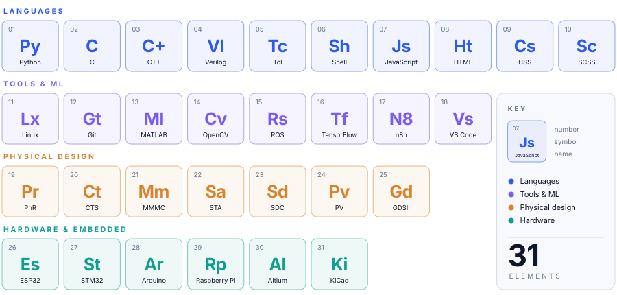
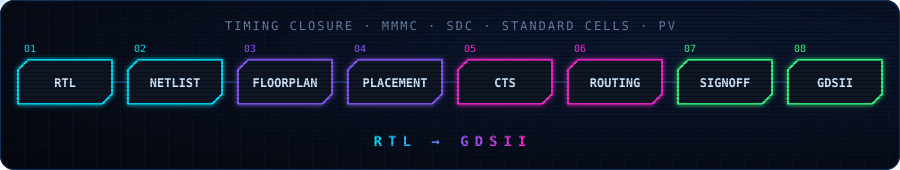
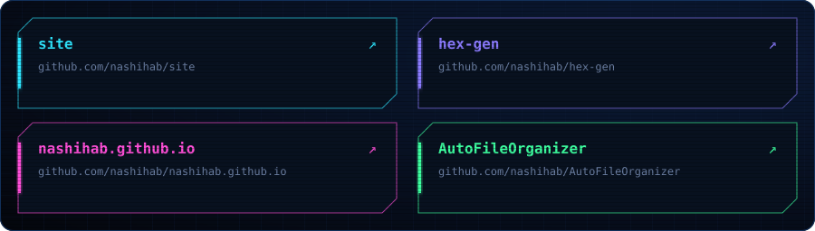

 

<table align="center">
<tr>
<td align="center" width="210">

### ⚡
**ASIC Physical Design**

PnR · CTS MMMC · STA · PV

</td>
<td align="center" width="210">

### 🔧
**Embedded Systems**

Firmware · Hardware IoT · Control

</td>
<td align="center" width="210">

### 🛰️
**Space & Robotics**

Nano-satellite UAV · UGV · ROV

</td>
<td align="center" width="210">

### ⚙️
**Automation**

Python · Tcl Shell · AI / ML

</td>
</tr>
</table>

<h2 align="center">⚔️ Tech Arsenal</h2>

<h2 align="center">⌬ IC Physical Design</h2>

<h2 align="center">Making Stuff · Just for Hobby</h2>

<h2 align="center">Momentum, made visible</h2>

  <a href="https://github.com/nashihab">GitHub</a> &nbsp;·&nbsp; <a href="https://nashihab.github.io">Website</a>

Circuits. Silicon. Code. Repeat.

